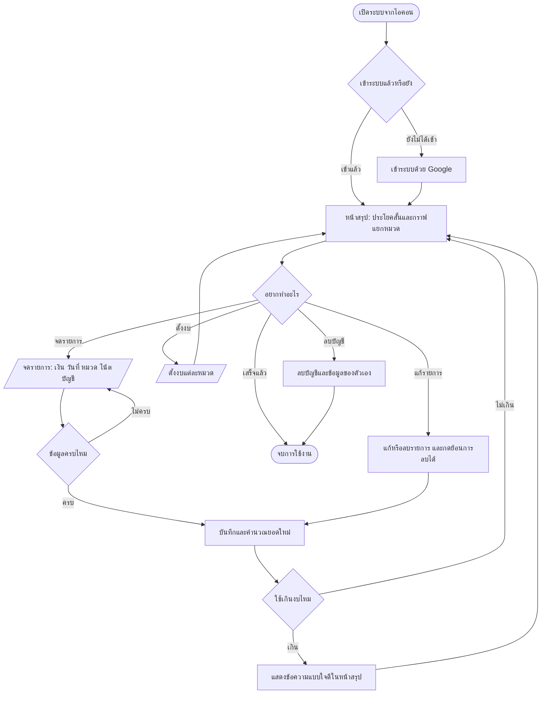
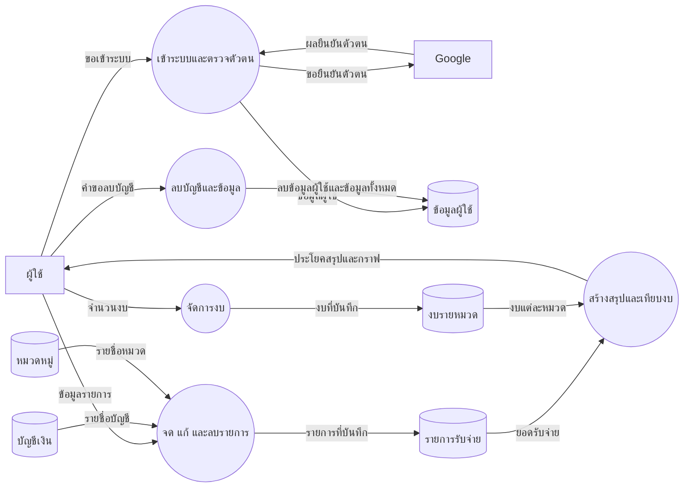
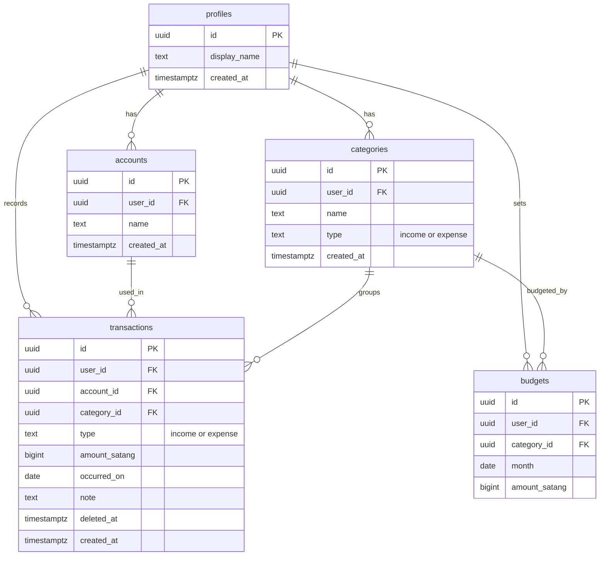

# แผนผังระบบ "เงินไปไหน"

ยืนยันโดยคุณฟัซมีเมื่อ 7 พฤศจิกายน 2569 (2026-11-07)

## 1. ขั้นตอนการใช้งาน

## 2. การไหลของข้อมูล

ข้อมูลเงินไม่ถูกส่งไปที่ Google โดย Google ทำหน้าที่ยืนยันตัวตนเท่านั้น

## 3. ตารางข้อมูล

## หมายเหตุการออกแบบ

- เก็บเงินเป็นหน่วยสตางค์ เพื่อให้บวกลบตรงทุกบาท
- ตอนกดลบ ระบบทำเครื่องหมายใน `deleted_at` ก่อน จึงกดย้อนการลบได้
- บัญชีเงินเก็บแค่ชื่อที่ผู้ใช้ตั้งเอง ไม่เก็บเลขบัญชีธนาคารจริง
